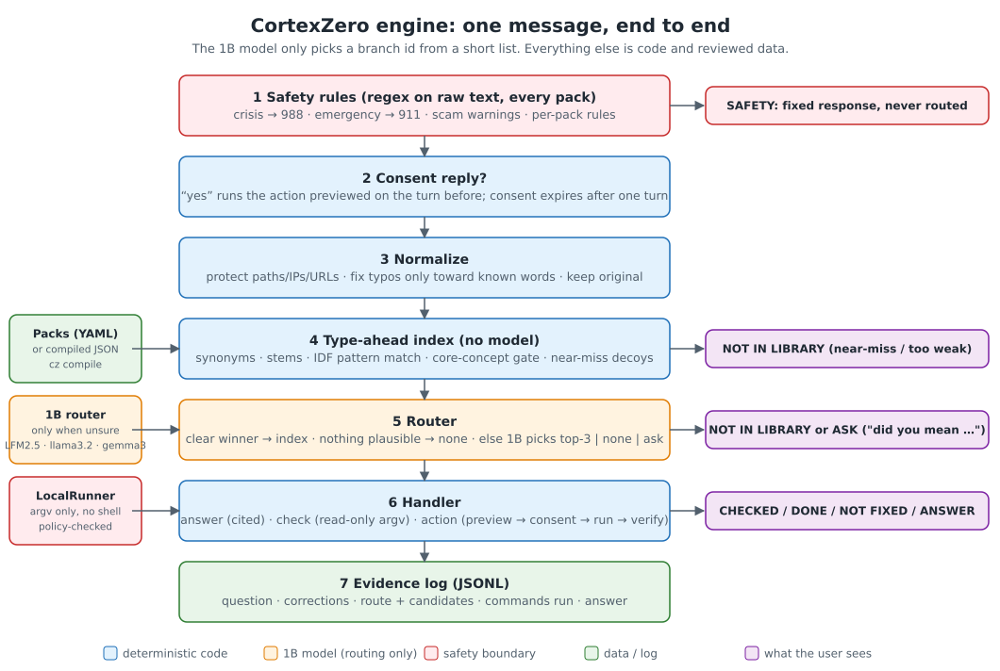
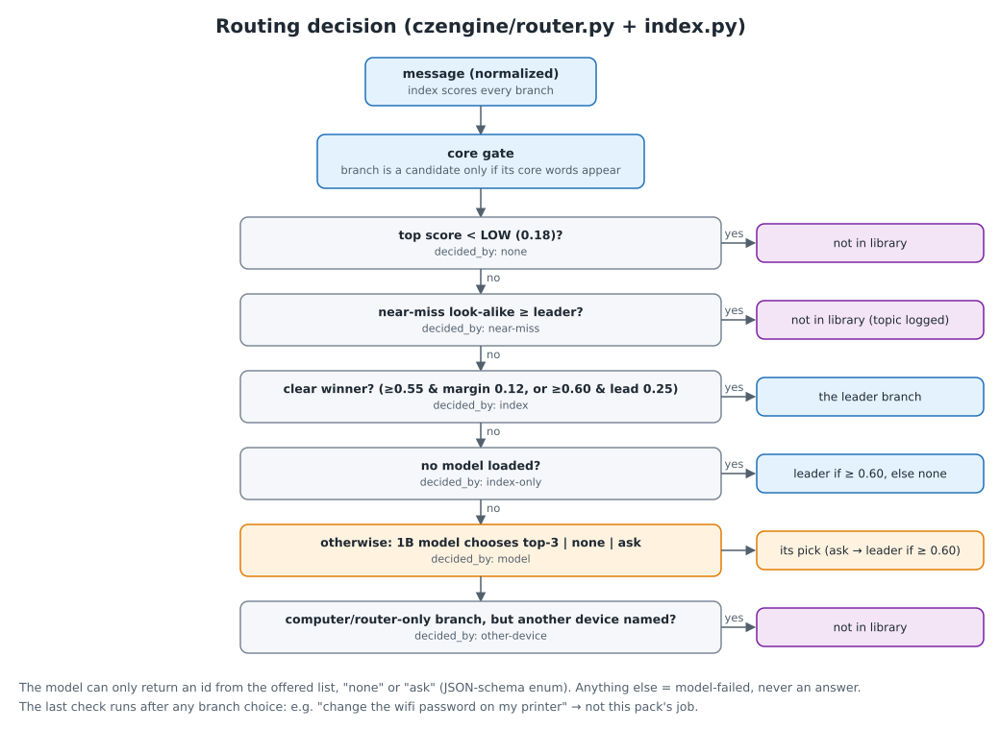
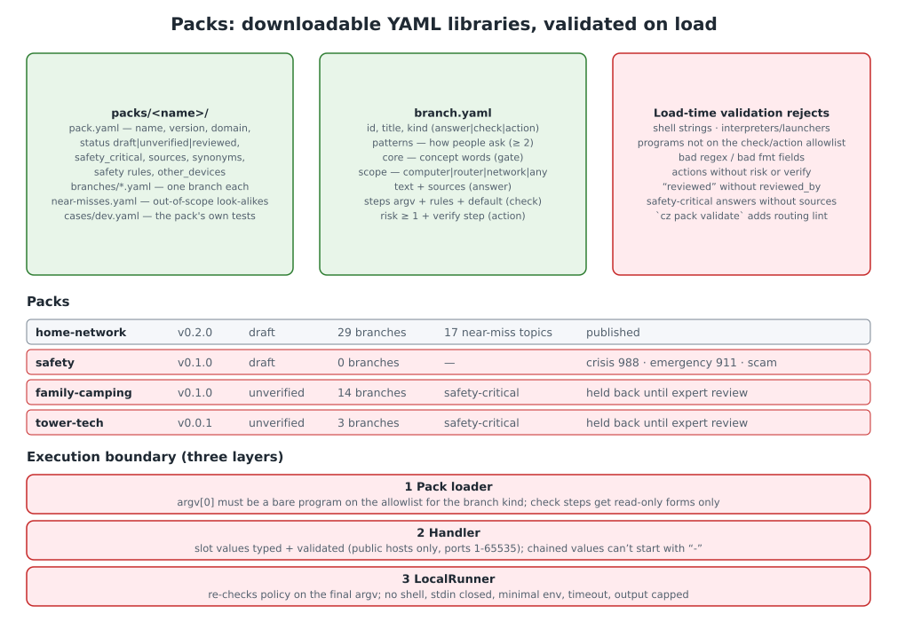
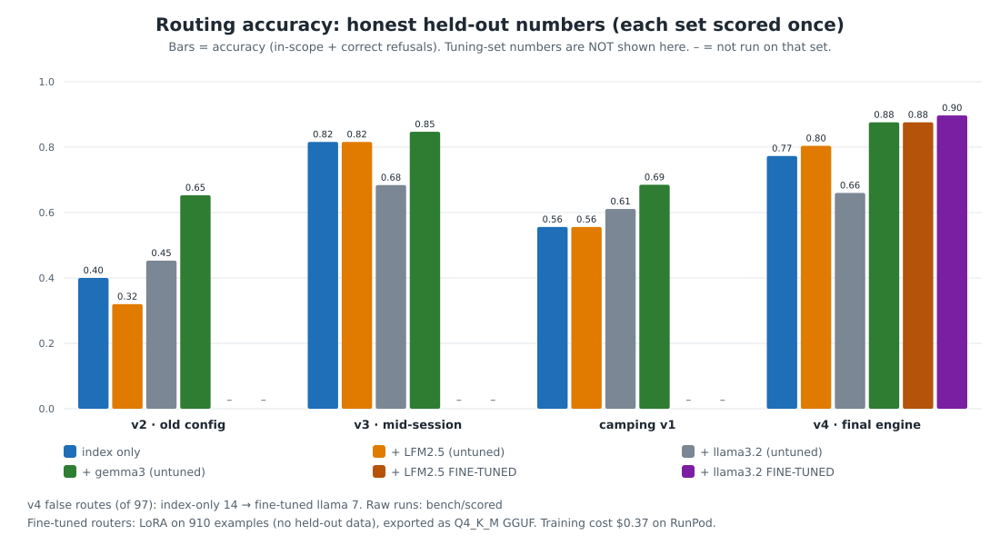
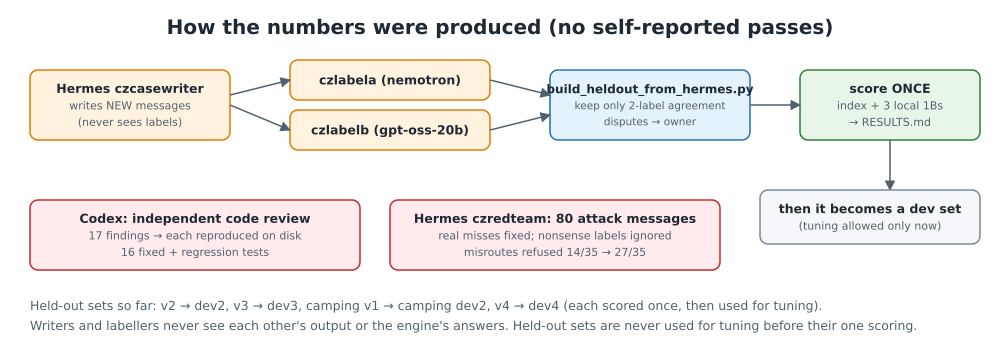

# CortexZero

**More capability. Same model.**

CortexZero is a help engine that lets a *tiny* language model, about 1 billion parameters, small enough to run
offline on an ordinary laptop, give reliable, checkable help. The model makes exactly one small decision: *which topic
is this message about?* Everything after that is ordinary code and human-written data. That includes the answer
text, the commands that check your computer, the safety rules, and the decision to refuse.

This repository is the **Python reference implementation**: the engine, two packs, the full benchmark data, the scored
results with charts, and the scripts that fine-tuned the 1B router.



---

## Why we built it

Small local models are private, free to run, and work without internet. But asked to *answer* questions, they make
things up, and if you let them run commands they're dangerous. Large hosted models are better at answering, but your
questions leave your machine, they cost money, and they still can't show you why they're right.

We asked a different question: **what if the model never answers at all?**

- A 1B model is surprisingly good at **routing**: picking the right topic from a short list of three.
- Answers, checks and fixes are **written once by people** in plain YAML "packs" and can be reviewed, cited and versioned.
- Commands are **fixed argument lists**: no shell ever, and the model can't invent one.
- Anything outside the library gets **"That's not in my library yet. I won't guess."** Being wrong is worse than
  saying no.
- Every turn is written to an **evidence log**: what was asked, how it was routed, which commands ran, what was said.

The result is a small model with abilities it could never produce on its own, plus an honest refusal when it's out
of its depth. Hence: *more capability, same model.*

## What it looks like

```
$ cz ask "my wifi says connected but nothing loads"
[✓ checked live] Your router (192.168.1.1) isn't answering. Restart it: unplug for 30 seconds, plug back in, wait 2 minutes.

$ cz ask "which router bit gives a clean round edge on oak"
[∅ not in library] That's not in my library yet. I won't guess. (Logged so it can be added.)

$ cz ask "reconnect my wifi"
[? needs your OK] Reconnect Wi-Fi: this will run the commands below (risk level 1). Reply 'yes' to run, anything else to cancel.
  $ nmcli radio wifi off
  $ sleep 2
  $ nmcli radio wifi on
  $ sleep 8

$ cz ask "my dad is having trouble breathing"
[⚠ safety] If someone is in danger, call 911 (or your local emergency number) now. I can't help with emergencies.
```
The first answer depends on what the live checks find on your machine; the wording comes from the pack, and the
model chooses none of it.

## How it works



1. **Safety rules first.** Regular expressions from every pack, run on the raw text: crisis → 988, emergencies → 911,
   phone/tech-support scams, plus any rules a pack adds. They are never routed and never model-dependent.
2. **Normalize.** Fix typos only toward words the library knows; protect paths, IPs and URLs.
3. **Index (no model).** Synonyms, word stems and IDF-weighted pattern matching. Two extra guards:
   - a **core-concept gate**: a branch can only win if its defining words are in the message;
   - **near-miss decoys**: look-alikes such as a woodworking *router*, a ship's *port* or your *Gmail* password,
     which pull the message toward "not in library".
4. **Router.** A clear winner is decided by the index alone. Nothing plausible means *none*. Only the ambiguous
   middle goes to the 1B model, which must answer with one of the offered ids, `none`, or `ask` (enforced by a JSON
   schema). A final **scope check** refuses computer- or router-only branches when the message is about another
   device ("the Wi-Fi password on my printer").
5. **Handler.** `answer` gives fixed text with sources. `check` runs read-only commands, and rules turn their output
   into a sentence. `action` shows a preview, asks for consent, runs, and verifies; it stops at the first failure.
6. **Evidence log** (JSON lines). `cz evidence --last 5` shows it.



**Execution boundary.** Pack steps are argv lists checked against an allowlist (`czengine/policy.py`). Shells,
interpreters and launchers are refused everywhere. Read-only checks may only use read-only programs and
sub-commands, and state-changing forms are allowed only in consented actions. The allowlist is checked when a pack
loads and again by the runner, which uses no shell, closes stdin, and runs with a minimal environment and a
timeout. User-supplied values are typed and validated: public hosts only, ports 1–65535, and chained values may not
start with `-`.

## Results: honest numbers

Every number below comes from a **held-out set**: messages written by a different LLM agent and labelled
independently by two more, keeping only the messages both labellers agreed on. Each set was **scored exactly once,
before any tuning on it**, and only then became a development set. The raw runs are in
[`bench/scored/`](bench/scored), and the full lab notebook, including failures, is
[`bench/RESULTS.md`](bench/RESULTS.md).



| held-out set | index only | + LFM2.5-1.2B | + llama3.2-1B | + gemma3-1B | **fine-tuned LFM** | **fine-tuned llama** |
|---|---|---|---|---|---|---|
| v2, early engine (75 msgs) | 0.400 | 0.320 | 0.453 | 0.653 | – | – |
| v3, mid-session engine (98) | 0.816 | 0.816 | 0.684 | 0.847 | – | – |
| camping v1, brand-new pack (54)¹ | 0.556 | 0.556 | 0.611 | 0.685 | – | – |
| **v4, final engine (97)** | 0.773 | 0.804 | 0.660 | 0.876 | **0.876** | **0.897** |

¹ Pack held back pending expert review (see [Packs](#packs)).

What we learned:
- **Structure beats size.** Core gates, decoys and scopes took the index from 0.40 to about 0.8 on fresh messages,
  with no model at all.
- **Untuned 1B models barely help, and sometimes hurt.** Off-the-shelf llama3.2-1B dropped accuracy to 0.66.
- **A cheap fine-tune changes that.** A LoRA on 910 routing examples (about 3.5 minutes on one GPU, $0.37 of rented
  compute in total) made the same 1B model the best component: **0.897**. It also halved false routes versus
  index-only (14 → 7 of 97).
- **What's still weak:** about 7% of fresh messages are still sent to the wrong topic. The v4 set has few
  out-of-scope messages, so refusal is only weakly measured. A brand-new pack with hand-written patterns starts
  around 0.55 until real phrasings are added.



We also had the engine reviewed independently. A separate code-review agent filed 17 findings; 16 were reproduced
and fixed with regression tests (the 17th is a fail-safe behaviour we chose to keep). A red-team agent wrote 80
adversarial messages, which led to the device-scope rule.

## Quickstart

```bash
git clone <this repo> && cd cortexzero-engine
pip install -e .                 # Python ≥ 3.10; the only dependency is PyYAML
cz pack list                     # installed packs, version, review status
cz ask "is my firewall on"
cz repl                          # conversation; hints appear as you type, Tab takes one
cz evidence --last 5             # what ran and why
```

Without installing: `./cz ask "..."`. The engine runs commands on **Linux** (NetworkManager/systemd for the
home-network pack). Answers-only packs work anywhere.

**Optional 1B router** via [Ollama](https://ollama.com): `cz ask --model llama3.2:1b "..."` works out of the box.
To use the fine-tuned router, train it with `runpod/finetune.sh` (or your own GPU via `runpod/finetune.py`) and
`ollama create` the GGUF. The weights are not in this repository. Index-only is the default.

**Optional online sources** (`--online`): an answer may name one https page; when switched on, a short cited, dated
and cached excerpt is appended after the pack's own text. Off by default; the offline answer is always complete.

## Packs

A pack is a folder of YAML files: `pack.yaml` (metadata, synonyms, safety rules), `branches/*.yaml`,
`near-misses.yaml` and `cases/`. `cz pack new NAME` scaffolds one; `cz pack validate` checks the schema and lints
routing (dead core words, patterns that don't route to their own branch, decoys that collide with real patterns).
`cz compile` precompiles packs into one JSON file for fast startup.

| pack | status | what's inside |
|---|---|---|
| `home-network` | draft | 29 branches: live checks (IP, DNS, Wi-Fi signal, packet loss, ports, certificates …), 3 consented actions, guides |
| `safety` | draft | crisis (988), emergencies (911), phone/tech-support scams |

Two more packs exist but are **held back**: `family-camping` (campfires, lightning, ticks, first aid …) and
`tower-tech` (OSHA fall protection, RF exposure). They are safety-critical, so they will be published only after a
qualified person has reviewed every fact. The camping pack's benchmark result is still reported above, as an
example of how a brand-new pack performs on first contact.

## Reproducing the benchmarks

```bash
python3 bench/run_bench.py bench/cases-dev4.yaml                         # index only
python3 bench/run_bench.py bench/cases-dev4.yaml --models llama3.2:1b    # + a 1B router via Ollama
python3 docs/make_diagrams.py                                            # rebuild the charts from bench/scored/
python3 -m pytest -q tests                                               # no model and no real commands needed
```

Case files: `bench/cases-dev*.yaml` (development, including the former held-out sets) and
`bench/cases-heldout*.yaml` (the sets as they were when scored). The `*-disputes.yaml` files hold the messages the
two labellers disagreed on, and `bench/train-hermes-r3.yaml` holds the extra training messages. All test messages are
synthetic: written by LLM agents, not real users.

## Repository layout

```
czengine/        the engine (index, router, handlers, policy, runner, packs, compiler, CLI)
packs/           home-network · safety
bench/           case sets, run_bench.py, scored runs, RESULTS.md, training-data builder
runpod/          GPU fine-tuning: finetune.py (LoRA → merged), finetune.sh (rent → train → GGUF → tear down)
docs/            ARCHITECTURE.md, diagrams + the script that draws them
tests/           engine tests (fake runner, fake model)
```

## Status and roadmap

This is a **reference implementation**: correct, tested and measured, not yet a polished product.

### 🚧 Coming next: the multi-language build

Work has started on a native build, where each part uses the language that suits it best:

| part | language |
|---|---|
| runtime engine: routing, safety, command runner, evidence log | **Rust**, one offline binary with no Python needed |
| 1B router | **llama.cpp**, built into the binary (Ollama stays optional) |
| packs | YAML → compiled JSON bundles |
| pack compiler, benchmarks, fine-tuning | **Python** (this code) |
| optional UI | TypeScript, talking to `cz serve` |

The rule for the port: **the Rust engine ships only when it gives the same route as this Python engine on every
benchmark case.** A conformance harness checks this in CI. This Python version stays as the reference and the
research bench.

Full plan: [docs/MULTI_LANGUAGE_PLAN.md](docs/MULTI_LANGUAGE_PLAN.md). Progress: see the
[tracking issue](../../issues?q=is%3Aissue+label%3Aroadmap).

Also planned: a fresh held-out set with more out-of-scope messages, more real phrasings for new packs, a fine-tuned
router per pack, and publishing the fine-tuned router weights.

## License

See [`LICENSE`](LICENSE).
